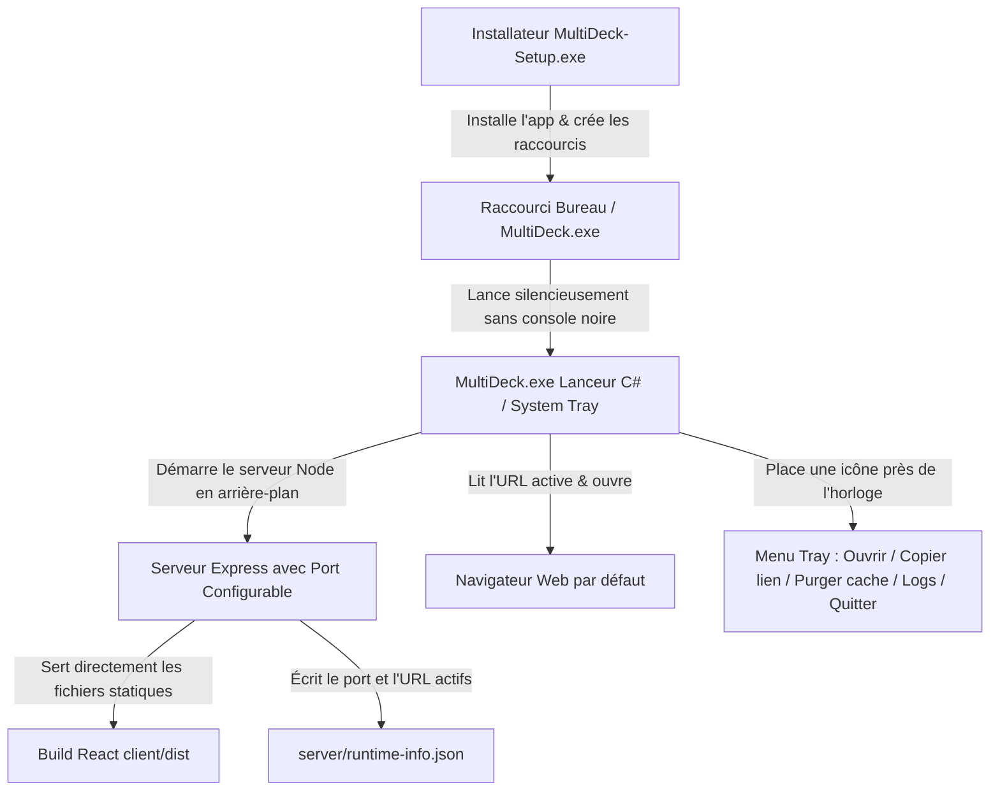

# MultiDeck — Guide d'Architecture, Déploiement et Packaging Autonome

> Ce document synthétise l'ensemble des échanges, des analyses d'architecture et des décisions retenues pour rendre **MultiDeck** accessible à distance, sécurisé, et diffusable au grand public sans friction technique.

---

## 📋 1. Synthèse des Échanges & Questions Clés

### A. Rendre le projet accessible en ligne (Maison vs Bureau)
* **Constat initial :** MultiDeck est composé d'un frontend React (Vite) et d'un backend Node.js (Express) utilisant **Playwright** pour extraire les données de X, Instagram et TikTok avec des profils de session stockés sur disque (`./server/user_data/`).
* **Solutions étudiées :**
  1. **Tailscale (VPN Mesh privé) — Recommandé pour usage perso :** Aucun port ouvert, gratuit, sécurisé à 100%, conserve l'IP résidentielle du PC hôte (pas de blocage de comptes).
  2. **Cloudflare Tunnel (Zero Trust) :** Permet d'avoir une URL HTTPS publique avec protection par mot de passe/code PIN par email, sans ouvrir de port sur la box.
  3. **VPS Cloud (Hetzner, OVH, etc.) :** Fait tourner le projet 24h/24, mais nécessite 2 à 4 Go de RAM et expose aux blocages d'adresses IP de datacenters par X et Instagram.

> **🔒 Accès distant désactivé par défaut.** Par sécurité, le serveur refuse toute requête qui ne vient pas du PC lui-même, ainsi que les noms d'hôte et origines inconnus (protection contre le CSRF et le DNS rebinding). Pour l'activer, ajoutez dans `server/.env` :
> ```env
> # Tailscale / réseau local : autoriser les autres machines
> MULTIDECK_ALLOW_REMOTE=true
> # Noms d'hôte ou IP utilisés dans l'URL (Tailscale MagicDNS, IP 100.x, domaine Cloudflare...)
> MULTIDECK_ALLOWED_HOSTS=monpc.tailnet.ts.net,100.101.102.103
> ```
> Avec **Cloudflare Tunnel**, `cloudflared` se connecte depuis le PC lui-même : seule la ligne `MULTIDECK_ALLOWED_HOSTS=deck.mondomaine.fr` est nécessaire.

---

### B. Emplacement du Cache et des Sessions lors d'une connexion distante
* **Cache des réseaux & Cookies (X / Instagram / TikTok) :**
  - **Emplacement : Sur le serveur hôte (à distance).**
  - Le cache mémoire (`CacheManager`, TTL de 3 à 5 min) et les profils Playwright (`./server/user_data/`) restent sur la machine qui exécute le backend.
  - **Bénéfice :** En vous connectant depuis le bureau ou votre mobile, vous êtes déjà connecté et vous bénéficiez du cache sans rescraper.
* **Agencement des colonnes & Thème visuel :**
  - **Emplacement : En local dans le navigateur (`localStorage`).**
  - La modale **Paramètres** propose l'export/import JSON pour transférer instantanément sa disposition de colonnes d'un poste à l'autre.

---

### C. Isolation des sessions et passage au Grand Public / Open-Source
* **Le piège du serveur centralisé (SaaS hébergé pour tout le monde) :**
  - **Blocage IP immédiat :** Des centaines d'utilisateurs scrapant X/Instagram depuis une même IP de serveur se feraient bloquer par les systèmes anti-bots des plateformes.
  - **Coût mémoire massif :** Chaque navigateur Chromium/Playwright actif consomme 200 à 300 Mo de RAM (50 utilisateurs simultanés = 15 Go de RAM).
  - **Risque légal :** Stocker les cookies de réseaux sociaux de tiers sur un serveur pose des problèmes de sécurité et RGPD.
* **Le choix optimal pour l'Open-Source : Le modèle Local Auto-Hébergé ("Self-Hosted") :**
  - Coût d'infrastructure pour le créateur : **0 €**.
  - Chaque utilisateur utilise sa propre adresse IP résidentielle (aucun risque de bannissement de masse).
  - Respect total de la vie privée des utilisateurs.

---

### D. Expérience utilisateur idéale : Le "1-Clic" sans ligne de commande
* **Exigence :** L'utilisateur lambda doit pouvoir double-cliquer sur un fichier ou une icône sans jamais voir de terminal, ni lancer de commandes `node`/`npm`.
* **Comportement attendu :**
  1. L'application démarre le serveur en arrière-plan.
  2. Le navigateur s'ouvre automatiquement sur la page de MultiDeck (`http://localhost:3001`).
  3. Une icône discrète se loge dans la **barre des tâches Windows (System Tray)** pour permettre de ré-ouvrir le site ou quitter proprement le programme (libération de la RAM).

---

## 🏆 2. Architecture & Solution Technique Validée

La solution repose sur **3 piliers complémentaires** :



1. **Unification Frontend + Backend avec Port Configurable :**  
   - Le serveur Express (`server/src/index.ts`) sert directement les fichiers compilés du frontend (`client/dist`).
   - Le port est **configurable** (CLI `--port`, variable d'environnement `PORT`, ou par défaut `3001`).
   - En cas de port déjà occupé, le serveur trouve automatiquement le prochain port libre (`3002`, `3003`...) sans crash (`EADDRINUSE`).
2. **Lanceur d'arrière-plan avec barre des tâches (System Tray) :**  
   - `MultiDeck.exe` (compilé nativement sans console noire via `launcher/build-launcher.bat`).
   - Détecte l'instance unique (Mutex), attend que le serveur soit prêt, et ouvre le navigateur par défaut.
   - Menu contextuel : *Ouvrir MultiDeck*, *Copier le lien local*, *Purger le cache*, *Voir les logs*, *Quitter MultiDeck* (arrête proprement Node.js et Playwright).
3. **Installeur Windows standard (Inno Setup) :**  
   - Fichier de configuration [`MultiDeck-Setup.iss`](file:///c:/Users/Holig/Desktop/Dev/MultiDeck/MultiDeck-Setup.iss).
   - Génère `installer_output/MultiDeck-Setup.exe` avec raccourcis Bureau et Menu Démarrer.

---

## 🛠️ 3. Commandes & Scripts Utiles

```bash
# 1. Compiler tout le projet (Client React + Serveur Node + Lanceur Windows MultiDeck.exe)
npm run build:all

# 2. Compiler uniquement le lanceur System Tray MultiDeck.exe
npm run build:launcher

# 3. Lancer le serveur unifié directement en ligne de commande
npm run start:prod

# 4. Générer l'installeur Windows avec Inno Setup (si Inno Setup 6 est installé)
iscc MultiDeck-Setup.iss
```

---
*Fichier mis à jour pour le projet MultiDeck.*

