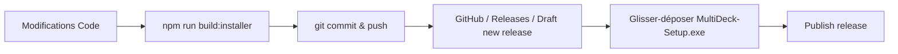

# 📦 Guide de Publication & Distribution des Releases GitHub

Ce guide décrit pas à pas la méthode pour générer l'installateur autonome **`MultiDeck-Setup.exe`** et le rendre directement téléchargeable pour vos utilisateurs depuis votre dépôt GitHub via les **GitHub Releases**.

---

## 💡 Pourquoi utiliser les GitHub Releases ?

* **Téléchargement direct 1-clic :** Les utilisateurs téléchargent directement le fichier d'installation `.exe` sans avoir besoin de cloner le dépôt, ni de manipuler de code.
* **Dépôt Git allégé :** Le fichier `.exe` (~26 Mo) n'alourdit pas l'historique Git du projet, ce qui garde les commandes `git clone` et `git pull` ultra rapides.
* **Hébergement gratuit et fiable :** GitHub prend en charge l'hébergement des binaires (jusqu'à 2 Go par fichier) avec une bande passante optimisée.

> [!NOTE]
> **Pourquoi GitHub génère-t-il des fichiers `.zip` ?**  
> Lorsque vous publiez une version, GitHub crée **systématiquement et automatiquement** deux archives du code source : `Source code (zip)` et `Source code (tar.gz)`.  
> Pour que vos utilisateurs puissent télécharger l'application prête à l'emploi, il suffit de glisser votre fichier **`MultiDeck-Setup.exe`** dans la section des fichiers attachés (*Assets*).

---

## 🛠️ Étape 1 : Compiler l'installateur en local

Avant de publier, assurez-vous de compiler la dernière version de l'application :

1. Ouvrez un terminal à la racine du projet :
   ```bash
   npm run build:installer
   ```
2. Cette commande automatise l'ensemble du processus :
   - Compile le frontend React (`client/dist`).
   - Compile le backend Node.js / Express (`server/dist`).
   - Télécharge `node.exe` autonome si absent (`node/`).
   - Compile le lanceur Windows natif (`MultiDeck.exe`).
   - Génère l'installateur Inno Setup.
3. Le fichier prêt à la distribution se trouve dans :
   📁 **`installer_output\MultiDeck-Setup.exe`** *(~26.5 Mo)*

---

## 🚀 Étape 2 : Publier l'exécutable sur GitHub

### A. Si la release existe déjà (cas de la v1.0.0 actuelle) :
1. Allez sur la page de votre release :  
   👉 [https://github.com/Holig/MultiDeck/releases/tag/v1.0.0](https://github.com/Holig/MultiDeck/releases/tag/v1.0.0)
2. En haut à droite, cliquez sur le bouton **✏️ « Edit »** (Modifier la version).
3. Faites défiler la page vers le bas jusqu'au rectangle en pointillés :  
   > **« Attach binaries by dropping them here or selecting them »**
4. Glissez-déposez le fichier **`installer_output\MultiDeck-Setup.exe`** dans cette zone (ou cliquez pour le sélectionner).
5. **Attendez que la jauge de chargement se termine.** Vous verrez apparaître :  
   `MultiDeck-Setup.exe` *(~26.5 MB)* avec une icône de corbeille.
6. Cliquez sur le bouton vert **« Update release »**.

---

### B. Pour créer une nouvelle release lors d'une prochaine mise à jour (ex: `v1.0.1`) :
1. Rendez-vous sur la page des releases de votre dépôt :  
   👉 [https://github.com/Holig/MultiDeck/releases](https://github.com/Holig/MultiDeck/releases)
2. Cliquez sur le bouton vert **« Draft a new release »**.
3. Renseignez les informations :
   - **Choose a tag :** tapez le nouveau numéro de version (ex: `v1.0.1`) puis cliquez sur *« Create new tag on publish »*.
   - **Target :** laissez sur `main`.
   - **Release title :** exemple : `MultiDeck v1.0.1 — Améliorations et correctifs`.
   - **Description :** listez les nouveautés ou correctifs.
4. Glissez-déposez le fichier **`installer_output\MultiDeck-Setup.exe`** dans le rectangle en pointillés.
5. Patientez pendant l'envoi du fichier jusqu'à la fin de la jauge.
6. Cliquez sur **« Publish release »**.

---

## 🔗 Liens de Téléchargement Direct pour vos Utilisateurs

Une fois l'exécutable attaché à la release, vos utilisateurs peuvent le télécharger via :

* **Lien permanent universel (pointe toujours vers la dernière version publiée) :**
  ```text
  https://github.com/Holig/MultiDeck/releases/latest/download/MultiDeck-Setup.exe
  ```

* **Lien spécifique à la version v1.0.0 :**
  ```text
  https://github.com/Holig/MultiDeck/releases/download/v1.0.0/MultiDeck-Setup.exe
  ```

---

## 🎨 Étape 3 : Ajouter un bouton de téléchargement dans le `README.md`

Vous pouvez insérer ce bloc tout en haut de votre `README.md` pour donner un accès immédiat à vos visiteurs :

```markdown
<p align="center">
  <a href="https://github.com/Holig/MultiDeck/releases/latest/download/MultiDeck-Setup.exe">
    
  </a>
</p>
```

---

## 🔄 Récapitulatif du Cycle Complet de Mise à Jour



1. Modifiez votre code et testez.
2. Lancez `npm run build:installer`.
3. Poussez vos modifications : `git add .`, `git commit -m "..."`, `git push origin main`.
4. Créez la release sur GitHub et attachez le nouveau `MultiDeck-Setup.exe`.
5. Validez avec **Publish release** !
