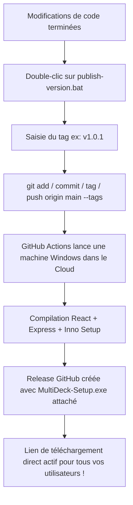

# 📦 Guide de Publication & Distribution Automatique (GitHub Actions)

Ce guide décrit comment publier une nouvelle version de **MultiDeck** et mettre à jour automatiquement l'installateur autonome **`MultiDeck-Setup.exe`** téléchargeable sur GitHub sans aucune manipulation manuelle.

---

## ⚡ Méthode Recommandée : Publication 1-Clic Automatique (GitHub Actions)

Grâce au workflow d'automatisation [`.github/workflows/release.yml`](.github/workflows/release.yml) et au script [`publish-version.bat`](publish-version.bat), vous n'avez plus besoin de compiler l'installateur sur votre PC ni de le glisser-déposer sur GitHub.

### Comment publier une nouvelle version en 1 commande :

1. À la racine du projet, lancez simplement :
   ```bash
   publish-version.bat
   ```
   *(ou double-cliquez directement sur le fichier `publish-version.bat` dans l'explorateur Windows, ou tapez `npm run release`)*

2. Le script vous demande deux informations :
   - **Le tag de version :** par exemple `v1.0.1` (ou `v1.0.2`, `v1.1.0`...)
   - **Le message de commit :** par exemple `Corrections et améliorations` (ou appuyez directement sur Entrée pour le message par défaut).

3. Le script exécute automatiquement :
   ```bash
   git add .
   git commit -m "Corrections et améliorations"
   git tag v1.0.1
   git push origin main --tags
   ```

4. **GitHub prend le relais dans le cloud :**
   - Une machine virtuelle Windows démarre sur GitHub.
   - Elle compile React, Express, le lanceur C# et Inno Setup.
   - Elle génère `MultiDeck-Setup.exe` et le publie automatiquement dans la Release.
   - ⏱️ Durée : environ 2 à 3 minutes.

> 📊 **Suivre la compilation en direct :**  
> Vous pouvez voir la compilation tourner en temps réel sur :  
> 👉 [https://github.com/Holig/MultiDeck/actions](https://github.com/Holig/MultiDeck/actions)

---

## 🔗 Lien Permanent de Téléchargement Direct pour vos Utilisateurs

Dès que la compilation est terminée, vos utilisateurs peuvent télécharger directement la dernière version de l'installateur via ce lien universel :

> **Lien direct :**  
> `https://github.com/Holig/MultiDeck/releases/latest/download/MultiDeck-Setup.exe`

Ce lien reste le même pour toutes les versions futures : il pointera toujours automatiquement vers le `.exe` le plus récent !

---

## 🔘 Badge de Téléchargement dans le README

Le `README.md` intègre déjà le badge officiel pointant vers ce lien :

<p align="center">
  <a href="https://github.com/Holig/MultiDeck/releases/latest/download/MultiDeck-Setup.exe">
    
  </a>
</p>

---

## 🛠️ Méthode Manuelle (Secours / Test Local)

Si vous souhaitez tester l'installateur localement sur votre PC avant de publier :

1. **Compiler en local :**
   ```bash
   npm run build:installer
   ```
   Le fichier est généré dans `installer_output\MultiDeck-Setup.exe`.

2. **Tester l'installateur :** Double-cliquez dessus sur votre PC pour vérifier que l'installation se passe bien.

3. **Publier manuellement :**
   - Allez sur [https://github.com/Holig/MultiDeck/releases](https://github.com/Holig/MultiDeck/releases).
   - Cliquez sur **« Draft a new release »** (ou modifiez une release existante).
   - Glissez-déposez `installer_output\MultiDeck-Setup.exe` dans le rectangle en pointillés (*Attach binaries*).
   - Validez avec **Publish release**.

---

## 🔄 Récapitulatif du Cycle Automatique


