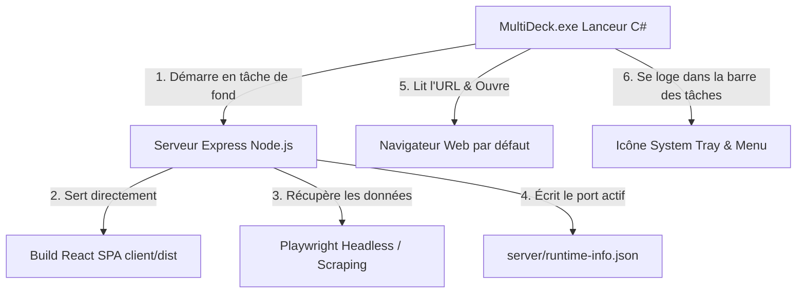

# 🛠️ MultiDeck — Guide d'Architecture Technique & Génération de l'Exécutable (.exe)

Ce document détaille le fonctionnement technique interne de **MultiDeck** ainsi que toutes les étapes pour recompiler et générer l'exécutable autonome Windows (`MultiDeck.exe`) et son installeur (`MultiDeck-Setup.exe`).

---

## 🏗️ 1. Architecture Technique Globale

MultiDeck est conçu selon un modèle **Self-Hosted / Local 1-Clic** : aucune donnée ne transite par un serveur externe. Tout s'exécute directement sur la machine de l'utilisateur.



### Les 4 Composants Clés :
1. **Le Frontend React (client) :**  
   - Construit avec React 18, Vite, TailwindCSS et Lucide Icons.
   - Interface multi-colonnes dynamique et responsive avec support des thèmes (*Clair*, *Bleu Nuit*, *Noir Absolu*).
   - Les appels API utilisent des chemins relatifs (`/api/...`), ce qui rend le client immédiatement fonctionnel sur n'importe quel port.

2. **Le Backend Express unifié (server) :**  
   - Sert à la fois les routes d'API (`/api/feed/*`, `/api/auth/*`, `/health`) et les fichiers statiques compilés du frontend (`client/dist`).
   - Gère le fallback SPA sur `index.html` pour toute route non-API.

3. **Le Moteur de Session & Scraping (Playwright & Cookies) :**  
   - Récupère les flux X, YouTube, TikTok et Instagram.
   - Stockage 100% local des profils et cookies dans `server/user_data/`.
   - Isolation des processus via `-no-remote`, `-new-instance` et `MOZ_NO_REMOTE=1` pour éviter tout conflit avec vos navigateurs personnels.
   - **Vérification de session ultra-rapide (0.1ms)** : `checkSession()` lit les cookies sauvegardés sur disque sans démarrer de navigateur lourd en arrière-plan.

4. **Le Lanceur Windows Autonome (`MultiDeck.exe`) :**  
   - Application native Windows Forms / C# compilée en mode `winexe` (**0 fenêtre noire / console de commande**).
   - Démarre le serveur Node silencieusement, attend que l'URL soit prête et ouvre le navigateur par défaut.
   - Icône dans la zone de notification (près de l'horloge) avec menu contextuel :
     - 🌐 **Ouvrir MultiDeck** (ou double-clic sur l'icône)
     - 📋 **Copier le lien local**
     - 🧹 **Purger le cache** (mémoire et disque)
     - 📄 **Voir les logs** (`server/multideck.log`)
     - 🚪 **Quitter MultiDeck** (arrête proprement le processus Node.js et libère la RAM).

---

## 🔌 2. Gestion Dynamique des Ports & Anti-Conflit

Pour éviter toute erreur `EADDRINUSE` (port déjà occupé sur l'ordinateur de l'utilisateur) :

1. **Priorité de détection :**
   - Argument CLI : `node dist/index.js --port 3050` ou `-p 3050`
   - Variable d'environnement : `PORT=3050` ou fichier `.env`
   - Port par défaut : `3001`
2. **Auto-fallback intelligent :**
   - Si le port demandé est déjà utilisé, le serveur cherche automatiquement le prochain port disponible (`3002`, `3003`, etc.).
   - Le serveur inscrit le port et l'URL réels dans `server/runtime-info.json` pour que le lanceur `MultiDeck.exe` ouvre toujours la bonne adresse dans le navigateur.

---

## 📦 3. Comprendre les Formats de Distribution

| Format | Fichier | Rôle | Pour qui ? |
| :--- | :--- | :--- | :--- |
| **Lanceur Local** | `MultiDeck.exe` *(~42 Ko)* | Lanceur léger qui pilote les sous-dossiers locaux (`server/`, `client/dist/`). | Pour le développeur / usage local direct dans le dossier du projet. |
| **Installeur Tout-en-Un** | `MultiDeck-Setup.exe` *(~80-120 Mo)* | **Fichier unique autonome** qui installe l'application, embarque toutes les dépendances et crée les raccourcis. | **Pour l'utilisateur final grand public (0 prérequis).** |
| **Archive Portable** | `MultiDeck-Portable.zip` | Dossier zippé complet autonome (lanceur + backend + frontend + node embarqué). | Pour utilisation portable sans installation (clé USB). |

> ⚠️ **Important :** Le fichier `MultiDeck.exe` seul (42 Ko) ne contient pas le serveur Node ni React. Pour distribuer MultiDeck à un utilisateur externe, fournissez-lui le fichier **`MultiDeck-Setup.exe`**.

---

## 🚀 4. Comment Générer le Fichier Tout-en-Un (`MultiDeck-Setup.exe`)

Pour fournir un exécutable unique et 100% autonome à un utilisateur lambda (qui n'a ni Node.js, ni Git, ni aucun outil technique installé) :

### Étape 1 : Installer Inno Setup 6 (une seule fois)
* Téléchargez et installez gratuitement [Inno Setup 6](https://jrsoftware.org/isdl.php) (30 secondes).

### Étape 2 : Lancer la génération Tout-en-Un

À la racine du projet, lancez simplement :

```bash
npm run build:installer
```

Ce script automatisé s'occupe de **TOUT** :
1. Compile le frontend React de production (`client/dist`).
2. Compile le backend TypeScript (`server/dist`).
3. Télécharge automatiquement le binaire officiel autonome `node.exe` dans le dossier `node/` (si non présent).
4. Compile le lanceur Windows natif `MultiDeck.exe` avec l'icône officielle.
5. Emballe le tout avec Inno Setup dans un **fichier d'installation unique** :  
   📁 **`installer_output\MultiDeck-Setup.exe`**

---

## 🛠️ 5. Commandes de Compilation Rapide

| Commande | Action effectuée |
| :--- | :--- |
| **`npm run build:installer`** | **Génère le fichier final Tout-en-Un `MultiDeck-Setup.exe`** (Client + Serveur + Node autonome + Inno Setup). |
| **`npm run build:all`** | Compile le client React, le serveur Express et le lanceur local `MultiDeck.exe`. |
| **`npm run build:launcher`** | Recompile uniquement le lanceur Windows `MultiDeck.exe` depuis `launcher/MultiDeckLauncher.cs`. |
| **`npm run start:prod`** | Démarre le serveur Express unifié en ligne de commande pour tester la production. |

---

## 🎨 6. Régénérer l'Icône Officielle (`assets/icon.ico`)

Si vous modifiez le design ou les couleurs de l'icône :

```powershell
powershell -ExecutionPolicy Bypass -File launcher\generate-icon.ps1
```

L'icône multi-résolutions (16x16, 32x32, 48x48, 64x64, 128x128, 256x256) sera régénérée dans `assets/icon.ico`.

---

## 📋 7. Structure des Fichiers du Projet

```text
MultiDeck/
├── MultiDeck.exe                  # Lanceur autonome local Windows (System Tray)
├── MultiDeck-Setup.iss            # Script Inno Setup pour le fichier d'installation Tout-en-Un
├── package.json                   # Scripts racine (build:installer, build:all, build:launcher)
├── assets/
│   └── icon.ico                   # Icône officielle haute fidélité (Layers Gradient)
├── node/
│   └── node.exe                   # Binaire Node.js autonome embarqué (0 prérequis utilisateur)
├── launcher/
│   ├── MultiDeckLauncher.cs       # Code source C# du lanceur System Tray sans console noire
│   ├── build-installer.bat        # Script batch de génération Tout-en-Un automatisée
│   ├── build-launcher.bat         # Script batch de compilation csc.exe
│   ├── download-node.ps1          # Téléchargement automatique de node.exe autonome
│   └── generate-icon.ps1          # Générateur d'icône Windows multi-résolutions
├── client/
│   ├── src/                       # Code source React (Components, Context, InfoModal)
│   └── dist/                      # Build de production React servi directement par Express
└── server/
    ├── src/                       # Code source Node.js / Express / Playwright
    ├── dist/                      # Code compilé JavaScript du backend
    ├── multideck.log              # Logs de l'application
    └── user_data/                 # Sessions et cookies stockés localement sur le PC
```

